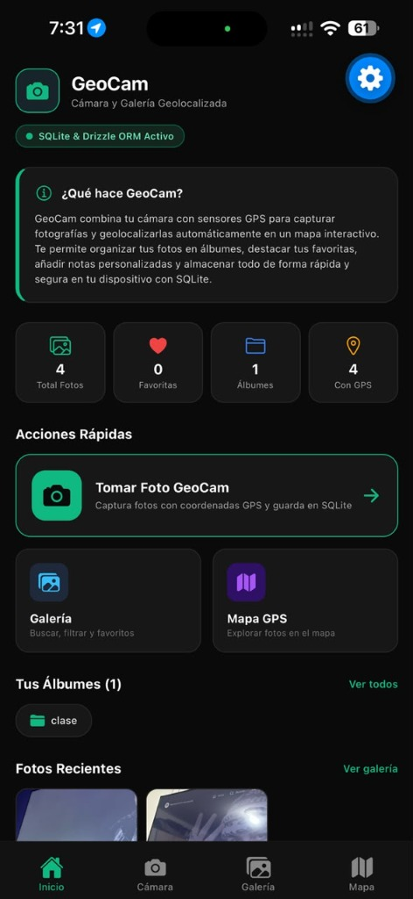
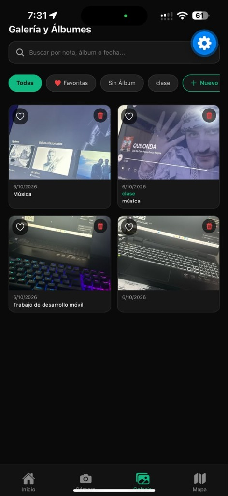
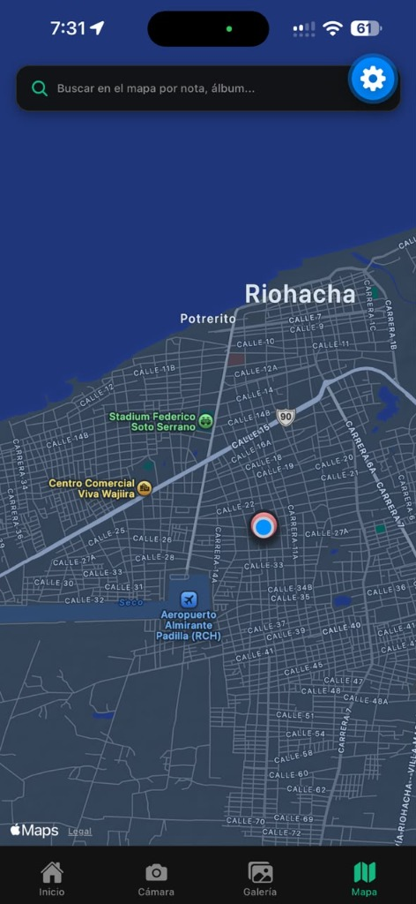

# GeoCam Persistente — Modulo CRUD con Drizzle ORM y SQLite

Aplicacion movil desarrollada con **Expo**, **React Native**, **TypeScript**, **Drizzle ORM** y **Expo SQLite** para el Taller Integrador de la Semana 7.

**Desarrollador:** Camilo Gomez  
**Semana:** 7 — Base de Datos Local Offline-First con Drizzle ORM y SQLite  
**Repositorio:** [https://github.com/camilogo22/GeoCam](https://github.com/camilogo22/GeoCam)  

---

## Caracteristicas Principales

- **Base de Datos Embebida Offline-First**: Implementacion completa con `expo-sqlite` y `drizzle-orm/expo-sqlite`, ejecutando con `PRAGMA foreign_keys = ON;` y `enableChangeListener: true`.
- **Relaciones y Llaves Foraneas (C1)**: Tabla `albums` relacionada con `photos` mediante la columna `albumId`. Regla `onDelete: 'set null'` para que al borrar un album sus fotos queden sin album pero no se eliminen.
- **Historial de Migraciones Versionadas (C2)**:
  - Migracion `0000_sturdy_omega_sentinel.sql`: Tablas iniciales `albums` y `photos`.
  - Migracion `0001_flippant_retro_girl.sql`: Adicion incremental de columnas `note` (texto) y `favorite` (booleano) preservando los datos existentes.
- **CRUD Completo de Fotos (C3)**: Pantalla dedicada `app/photo/[id].tsx` para ver metadatos y coordenadas, editar notas, alternar estado favorito, reasignar album y eliminar con confirmacion.
- **Busqueda y Filtros Reactivos (C4)**: Pantalla `app/(tabs)/galeria.tsx` con buscador en vivo por nota (operador `like`), filtro por favoritas y selector de albumes.
- **Persistencia Fisica en Documentos (C5)**: Modulo `services/photoFiles.ts` que copia fotos desde la cache temporal a la carpeta de documentos permanentes (`Paths.document`) y elimina el archivo fisico al borrar el registro de SQLite.
- **Modulos Nativos y Sensores**: Camara nativa (`expo-camera`), mapa interactivo (`react-native-maps`), acelerometro (`expo-sensors`) y geolocalizacion (`expo-location`).

---

## Capturas de Ejecucion en Dispositivo Fisico

| Pantalla Principal (Inicio) | Galería y Álbumes | Mapa GPS Interactiva |
| :---: | :---: | :---: |
|  |  |  |
| *Estadísticas de fotos, estado SQLite & Drizzle activo y fotos recientes.* | *Buscador por notas, filtro por álbumes ("clase") y fotos guardadas.* | *Detección de ubicación GPS y visualización en mapa (Riohacha, Colombia).* |

---

## Diagrama de Tablas de la Base de Datos

```text
+-----------------------------------+             +-----------------------------------+
|              albums               |             |              photos               |
+-----------------------------------+             +-----------------------------------+
| id: integer (PK, AutoIncrement)   |<------------| id: text (PK)                     |
| name: text (Unique, Not Null)     |  1       0..*| uri: text (Not Null)             |
| created_at: integer (Not Null)    |             | latitude: real                    |
+-----------------------------------+             | longitude: real                   |
                                                  | accuracy: real                    |
                                                  | source: text (camera/gallery)     |
                                                  | created_at: integer (Not Null)    |
                                                  | album_id: integer (FK, Set Null)  |
                                                  | note: text (Nullable)             |
                                                  | favorite: integer (Boolean, 0)    |
                                                  +-----------------------------------+
```

### Relacion:
- Un album puede contener de 0 a muchas fotos (`1` a `0..*`).
- Una foto pertenece opcionalmente a un album (`album_id` nullable).
- Regla referencial: `ON DELETE SET NULL`. Al eliminar un registro en `albums`, las fotos asociadas actualizan su campo `album_id` a `NULL` sin borrarse.

---

## Estructura del Proyecto

```text
semana-7/
├── app/
│   ├── (tabs)/
│   │   ├── _layout.tsx           # Pestañas: GeoCam, Galeria y Mapa
│   │   ├── geocam.tsx            # Pestaña 1: Camara, coordenadas y captura persistente
│   │   ├── galeria.tsx           # Pestaña 2: Busqueda por nota, filtros por album y favoritas
│   │   ├── mapa.tsx              # Pestaña 3: Mapa interactivo con marcadores y enlace a detalle
│   │   └── mapa.web.tsx          # Pestaña 3: Modo adaptado a navegador web
│   ├── photo/
│   │   └── [id].tsx              # Pantalla CRUD: Ver foto, editar nota, favorito, album y borrar
│   ├── _layout.tsx               # Root Layout con ejecucion de useMigrations()
│   └── index.tsx                 # Redireccion a /(tabs)/geocam
├── db/
│   ├── client.ts                 # Instancia de Drizzle ORM y activacion de PRAGMA foreign_keys
│   ├── schema.ts                 # Esquemas relacionales de albums y photos
│   └── repositories/
│       ├── photos.ts             # Consultas Drizzle listQuery, withLocationQuery y CRUD
│       └── albums.ts             # Consultas Drizzle de albumes
├── drizzle/                      # Carpeta versionada con migraciones SQL oficiales
│   ├── meta/
│   │   └── _journal.json         # Registro historico de migraciones
│   ├── 0000_sturdy_omega_sentinel.sql  # Migracion inicial: albums y photos
│   ├── 0001_flippant_retro_girl.sql    # Migracion 2: note y favorite
│   └── migrations.js             # Indice de migraciones empaquetadas para Expo
├── services/
│   ├── photoFiles.ts             # Persistencia permanente en Paths.document y borrado fisico
│   └── photosRepository.ts       # Integracion de repositorios Drizzle y FileSystem
├── hooks/
│   ├── usePhotos.ts              # Hook reactivo de fotos con useLiveQuery
│   ├── useAlbums.ts              # Hook reactivo de albumes con useLiveQuery
│   ├── useCamera.ts              # Hook nativo de camara
│   ├── useGeoLocation.ts         # Hook nativo de GPS
│   └── useShake.ts               # Hook con acelerometro
├── context/
│   └── GeoPhotosContext.tsx      # Proveedor global conectado a SQLite
├── types/
│   └── geo.ts                    # Modelos de datos TypeScript (GeoPhoto, Coords, AlbumItem)
├── screenshots/                  # Capturas de ejecucion en dispositivo fisico (iPhone)
│   ├── inicio.jpg
│   ├── galeria.jpg
│   └── mapa.jpg
├── drizzle.config.ts             # Configuracion de Drizzle Kit para Expo SQLite
├── metro.config.js               # Resolucion de archivos .sql para migraciones
├── babel.config.js               # Plugin inline-import para SQL
├── AI-LOG.md                     # Auditoria de IA de la Semana 7
└── README.md                     # Documentacion general del repositorio
```

---

## Verificacion de Criterios de Entrega

- [x] **Migraciones versionadas**: Se generaron dos migraciones (`0000` y `0001`) con `drizzle-kit generate` sin edicion manual.
- [x] **Preservacion de datos**: La segunda migracion anade columnas mediante `ALTER TABLE ADD COLUMN` manteniendo intactas las fotos previas.
- [x] **Separacion de capas**: Las pantallas no importan Drizzle directamente; consumen hooks y el repositorio de datos.
- [x] **CRUD y Reactividad**: Crear, ver detalle, editar notas, alternar favoritas, reasignar album y borrar funcionan con actualizacion reactiva de la interfaz.
- [x] **Archivos permanentes**: Fotos copiadas a `Paths.document` y eliminadas fisicamente al borrar su registro en SQLite.
- [x] **Compilacion TypeScript**: 0 errores de compilacion con `npx tsc --noEmit`.
